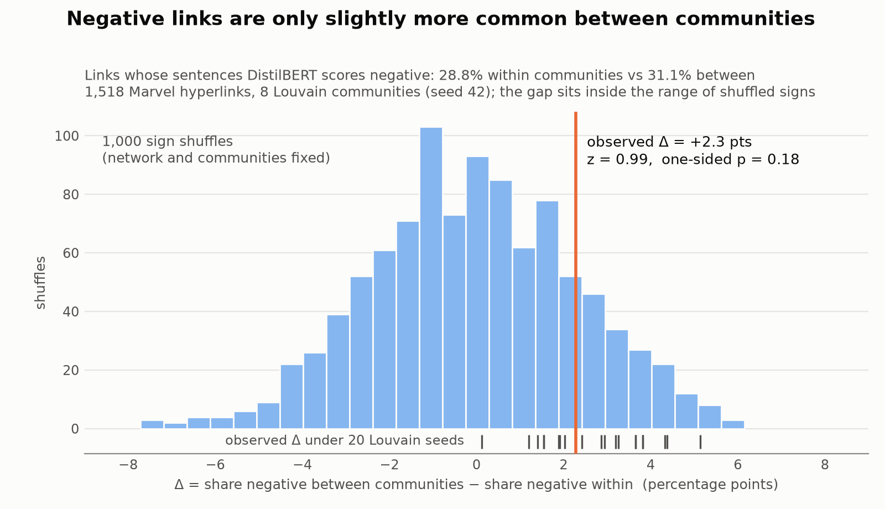

# Allies, enemies and the sentence behind the link

*Week 7 Go Nuts · Marvel text + network*

## What we asked

When Marvel character A's Wikipedia page links to character B, is the sentence where A mentions B positive or negative? Does that separate allies from enemies? And do "enemy" links run **between** network communities more than **within** them?

## What we measured, and why

- **The sentence behind each link.** The page text has no link markup, so we found B's *names* on A's page. Each character got a small alias table (title, alter ego, plus 61 hand-picked names such as Spider-Man → Peter Parker). We kept only story sections; "In other media" was mostly cast lists. **1,539 of 1,784 links (86.3%)** got at least one sentence, 5,320 sentences in total.
- **Three sentiment instruments** on every sentence, averaged per link:
  - DistilBERT (`distilbert-base-uncased-finetuned-sst-2-english`)
  - VADER
  - a small keyword list (*enemy, foe, rival, nemesis, killed, fought* vs. *ally, teammate, friend, married, partner, love*)
- **Validation before scaling up.** We hand-labeled 40 random links (16 ally, 2 family, 8 enemy, 14 neutral). We then asked how well each instrument ranks enemies below allies and family (AUC, 0.5 = chance):

| Instrument | Enemy → negative | Ally/family → positive | AUC [95% CI] |
|---|---|---|---|
| **DistilBERT** | 5/8 | 17/18 | **0.93** [0.80, 1.00] |
| VADER | 7/8 | 8/18 | 0.69 [0.44, 0.90] |
| Keywords | 3/8 | 4/18 | 0.76 [0.61, 0.90] |

- **Network test with DistilBERT.** We ran Louvain (seed 42) on the undirected giant component and got 8 communities (Q = 0.386). We then compared the share of negative links within and between communities. As the null model, we shuffled the signs across links 1,000 times, keeping the network fixed.

## The figure

Negative links make up **28.8%** of links within communities and **31.1%** between them, a difference of **Δ = +2.3 points**. Against 1,000 shuffles of the signs this gives **z = 0.99, one-sided p = 0.18**. The ticks under the histogram show Δ for 20 different Louvain seeds. It is positive every time (+0.1 to +5.1 points), but p ranges from 0.013 to 0.51 depending on the seed.

**Answer:** enemies are only slightly more common between communities than within them, and with this measurement we cannot tell the difference apart from chance.

Explore every link yourself (hover a dot to read its sentence):

<iframe src="assets/week7/links_interactive.html" width="100%" height="540" style="border:none;"></iframe>

## What surprised us

- **The instruments barely agree.** The rank correlation between them is 0.05–0.26. On single sentences, DistilBERT and VADER have the same sign only 61% of the time.
- **VADER reads action as hostility**, even when the two characters fight on the *same* side (DistilBERT +0.82, VADER −0.70):
  > "During the Fear Itself storyline, Anya, X-23, Amadeus Cho, Power Man, and Thunderstrike are teleported to a station in the middle of the Pacific Ocean where they fight samurai Shark Men."
- **DistilBERT is very sure about sentences that say nothing.** A 22-name tournament roster that includes Hyperion scores **+0.99**. Our 14 neutral links got scores from −0.99 to +1.00.

## What we checked in the raw text

We read the most negative links on each side of the community border:

- A real enemy link that crosses communities, Ricochet → Wolverine (DistilBERT −1.00):
  > "Ricochet becomes disillusioned because his efforts had not earned him any fame or recognition, and blames himself for Hornet's death at the hands of a brainwashed Wolverine."
- Negative, but misfortune rather than hostility, Robbie Baldwin → Steel Spider (−1.00):
  > "During the team's mission to capture Steel Spider, Penance suffers a mental breakdown."
- Negative, but it's editorial history, Zombie → Jericho Drumm (−1.00):
  > "…Simon Garth was reanimated in the horror-comics magazine Bizarre Adventures #33 (Dec. 1982), in an out-of-chronology story hard to reconcile with the remainder of the character's continuity."

So "negative" mixes hostility, bad luck and comic-book publishing history.

## One limitation

**The instruments score the sentence, not the relation between A and B.** The tone of a sentence often comes from a third party (a shared villain), from misfortune, or from editorial history. Our validation also rests on only 8 hand-labeled enemy links. Our null result therefore means "not detectable with sentence sentiment", not "enemy links don't cross communities".
